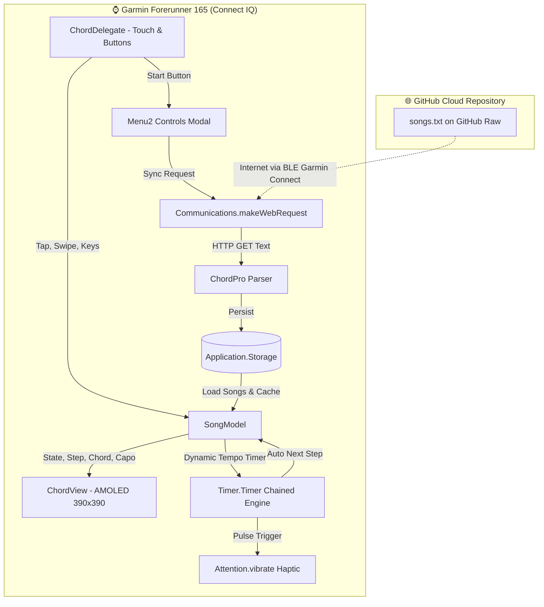

<div align="center">


# 🎸 GuitarPrompter
### *Stage-Ready Smart Wrist Teleprompter, Hands-Free Chords & Lyrics for Garmin AMOLED*

**Garmin Connect IQ Watch App** untuk **Forerunner 165 & 165 Music** (390×390 AMOLED)

[](https://developer.garmin.com/connect-iq/sdk/)
[](https://www.garmin.com/en-US/p/735520)
[](https://developer.garmin.com/connect-iq/reference-guides/devices-reference/)
[](https://github.com/NaufalFahrozi/GuitarPrompter/releases)
[](https://developer.garmin.com/connect-iq/monkey-c/)
[](LICENSE)

*"Tinggalkan stand partitur dan smartphone. Mainkan gitarmu di panggung, lirik & akord mengalir presisi di pergelangan tanganmu."*

</div>

---

## ✨ Tentang GuitarPrompter

**GuitarPrompter** adalah aplikasi prompter panggung cerdas (*stage teleprompter*) untuk jam tangan Garmin dengan layar melingkar 390×390 AMOLED. Dirancang khusus bagi musisi, gitaris panggung, busker, dan musisi kamar tidur yang ingin fokus bernyanyi dan memetik senar tanpa terdistraksi oleh stand partitur fisik atau layar smartphone yang silau.

Dengan **Hands-Free Dynamic Auto-Scroll**, getaran halus **Tactile Wrist Pulse (Haptic)**, dan **Cloud Web Sync** 1-ketuk langsung dari repositori GitHub, kamu selalu siap tampil di atas panggung tanpa resiko lupa chord atau lirik!

---

## 📸 Antarmuka Panggung & Layout Layar (390×390 AMOLED)

```text
                     ╭───────── 390×390 AMOLED ─────────╮
                     │         [▶ AUTO 1.0x]            │  <-- Status Mode & Speed Multiplier
                     │   Take Me Home • CAPO 3          │  <-- Judul Lagu & Capo Badge
                     │                                  │
                     │         ╭──────────────╮         │
                     │         │      G       │         │  <-- NOW (Active Chord): Electric Green
                     │         ╰──────────────╯         │
                     │   Almost heaven, West Virginia   │  <-- Active Lyric (Smart 2-line wrapped)
                     │                                  │
                     │               Em                 │  <-- NEXT (Preview Chord): Ice Cyan
                     │   Blue Ridge Mountains, Shen...  │  <-- Preview Lyric (Muted gray)
                     │                                  │
                     │  ━━━━━━━━━━━━━━━━━━━━━━━━━━━━━   │  <-- Outer Circular Bezel Progress Arc
                     ╰──────────────────────────────────╯
```

### 🎯 Tampilan Panggung Dual-Card (NOW & NEXT)
1. **Header & Capo Pill (Atas)**: Menampilkan judul lagu aktif dan lencana capo berwarna oranye neon (misal `CAPO 3` / `CAPO 7`) secara otomatis dari metadata lagu.
2. **Kartu Kunci Aktif (NOW - Tengah)**: Akord yang sedang dimainkan dirender dengan font kontras tinggi berwarna **Electric Emerald Green (`0x00FF7F`)** beserta baris lirik aktif yang dibungkus rapi.
3. **Kartu Kunci Berikutnya (NEXT - Bawah)**: Akord dan potongan lirik yang akan datang dirender dengan aksen **Ice Cyan (`0x80CBC4`)** dan teks abu-abu lembut agar jari tanganmu siap beralih posisi kunci.
4. **Circular Bezel Progress Arc (Pinggir Bezel)**: Garis busur melingkar 360° yang terus bergerak searah jarum jam mengelilingi tepi terluar bezel jam tangan seiring berjalannya lagu hingga selesai (`100%`).

---

## ⚡ Fitur Utama

### 1. ⏱️ Hands-Free Dynamic Auto-Scroll
- Menggulirkan akord secara otomatis mengikuti metadata tempo dan durasi asli lagu (`[Chord:Seconds]`).
- Tangan tetap bebas memetik gitar tanpa harus terus-menerus menyentuh jam tangan.
- Menampilkan indikator status aktif `[▶ AUTO]` atau `[▶ AUTO 1.2x]` di bagian paling atas layar.

### 2. 🎚️ Practice Speed Multiplier (`0.8x` • `1.0x` • `1.2x` • `1.5x`)
- Butuh latihan lambat untuk lagu baru yang sulit? Pilih kecepatan `0.8x`.
- Ingin latihan up-tempo atau pemanasan jari cepat? Geser kecepatan ke `1.2x` atau `1.5x`.
- Siklus kecepatan dapat diubah langsung dalam 1 ketukan dari menu kontrol.

### 3. 📳 Tactile Wrist Haptic Pulse
- Setiap kali kunci berpindah, jam tangan memberikan getaran taktil halus (*wrist buzz* 70ms, 40% duty cycle).
- Memungkinkan gitaris tetap menatap fretboard, jari, atau penonton tanpa harus terus memelototi layar jam.
- Dapat diaktifkan / dinonaktifkan sesuka hati dari menu.

### 4. 📜 Smart Balanced 2-Line Lyric Wrapping
- Layar jam tangan Garmin berbentuk lingkaran, sehingga baris teks panjang rawan terpotong oleh bezel kiri dan kanan.
- GuitarPrompter memiliki algoritma pembungkus kata cerdas yang otomatis menyeimbangkan lirik panjang menjadi 2 baris proporsional sehingga selalu terbaca aman di dalam lingkaran 390×390.

### 5. 🧢 Intelligent Capo Detection & Badges
- Mendeteksi perintah capo pada lagu (seperti `{capo: Capo 3}` atau teks judul `(Capo 7)`).
- Menampilkan lencana neon terang di header sehingga kamu tahu persis fret mana yang harus dipasangi capo sebelum mulai bernyanyi.

### 6. 🔄 Direct Cloud Web Sync (GitHub Raw)
- Ingin menambah lagu baru atau mengedit chord? Cukup commit ke file [`songs.txt`](./songs.txt) di repositori ini.
- Buka jam tanganmu, pilih **Sync from Web** di menu, dan lagu terbaru akan langsung diunduh lewat Bluetooth/WiFi smartphone dan disimpan permanen di `Application.Storage` jam tangan!

### 7. 🌑 Pure Black AMOLED Battery Optimization
- Seluruh antarmuka menggunakan latar hitam pekat (`#000000`).
- Pada layar AMOLED Garmin Forerunner 165, piksel hitam benar-benar mati (*zero power draw*), menghasilkan kontras panggung tak hingga sekaligus menghemat daya baterai jam secara maksimal.

---

## 🎵 Setlist Lagu Bawaan (Preloaded Songs)

Semua lagu bawaan dirancang dengan **chord terbuka (open chords)** ramah pemula tanpa barre chord rumit:

| # | Lagu | Artis | Tuning / Capo | Kunci yang Digunakan | Karakter / Nuansa |
|---|------|-------|---------------|----------------------|-------------------|
| 1 | **Take Me Home, Country Roads** | John Denver | No Capo (Std) | `G`, `Em`, `D`, `C`, `D7` | Folk / Sing-Along Santai |
| 2 | **Hey Jude** | The Beatles | Capo 3 (Key D) | `D`, `A`, `G`, `D7`, `Bm`, `Em`, `A7`, `C` | Pop Klasik Anthemic |
| 3 | **Here Comes The Sun** | The Beatles | Capo 7 (Key D) | `D`, `G`, `A7`, `E7`, `C` | Akustik Ceria & Hangat |
| 4 | **Creep** | Radiohead | Capo 7 (Key C) | `C`, `E`, `F`, `Fm` | Grunge / Emosional |
| 5 | **Fake Plastic Trees** | Radiohead | No Capo (Std) | `D`, `Dsus4`, `G`, `Em`, `A` | Indie Rock Akustik Melankolis |
| 6 | **Walking Back Home** | Vira Talisa | No Capo (Std) | `C`, `Em`, `Fmaj7`, `G`, `Dm`, `Am` | Indie Pop / Bossa Nova Sore Hari |

---

## 🕹️ Skema Kontrol & Navigasi

### 👆 Layar Sentuh (Touchscreen)

```text
              ╭───────────────────────────────╮
              │   Zona Atas (y < 80)          │  --> Kunci Sebelumnya (Prev)
              │───────────────────────────────│
              │   Zona Tengah (y: 80 - 160)   │  --> Play / Pause Auto-Scroll
              │───────────────────────────────│
              │   Zona Bawah (y > 160)        │  --> Kunci Berikutnya (Next)
              ╰───────────────────────────────╯
```

| Interaksi Layar | Gestur | Hasil |
| :--- | :--- | :--- |
| **Zona Tengah** ($y: 80 - 160$) | Tap | Toggle Play / Pause Auto-Scroll |
| **Zona Bawah** ($y > 160$) | Tap | Maju ke kunci / lirik berikutnya |
| **Zona Atas** ($y < 80$) | Tap | Mundur ke kunci / lirik sebelumnya |
| **Geser Kiri / Atas** | Swipe Left / Up | Maju ke kunci berikutnya |
| **Geser Kanan / Bawah** | Swipe Right / Down | Mundur ke kunci sebelumnya |

### 🔘 Tombol Fisik (Hardware Buttons)

| Tombol | Posisi | Fungsi |
| :--- | :--- | :--- |
| **START / ENTER** | Kanan Atas | Buka **Menu Kontrol** (Play/Pause, Speed, Haptic, Setlist, Sync) |
| **DOWN** | Kiri Bawah | Maju ke kunci berikutnya |
| **UP** | Kiri Tengah | Mundur ke kunci sebelumnya |
| **BACK / LAP** | Kanan Bawah | Keluar dari aplikasi |

---

## 📋 Menu Kontrol (Start Button)

Tekan tombol **START / ENTER** (kanan atas) kapan saja untuk membuka menu navigasi:

1. `▶ Auto-Scroll: ON / OFF`: Mengaktifkan atau menjeda mode auto-scroll hands-free.
2. `⚡ Speed: 1.0x`: Siklus kecepatan latihan (`1.0x` $\rightarrow$ `1.2x` $\rightarrow$ `1.5x` $\rightarrow$ `0.8x`).
3. `📳 Haptic: ON / OFF`: Menghidupkan atau mematikan getaran denyut pergelangan tangan.
4. `⏮ Restart Song`: Mengulang lagu yang sedang aktif dari kunci pertama.
5. **Daftar Lagu (Setlist Picker)**: Pilih judul lagu untuk langsung berpindah lagu.
6. `🔄 Sync from Web`: Mengunduh versi terbaru `songs.txt` langsung dari GitHub via internet handphone.
7. `⚠️ Reset Defaults`: Mengembalikan daftar lagu ke konfigurasi bawaan pabrik.

---

## 🎼 Panduan Menambah Lagu Sendiri (Format ChordPro)

Kamu bisa memodifikasi [`songs.txt`](./songs.txt) di repositori ini untuk memasukkan daftar lagumu sendiri. GuitarPrompter menggunakan format standar ChordPro yang disempurnakan dengan durasi detik:

```text
# Wonderwall - Oasis (Capo 2)
{capo: Capo 2}
[Em7:3.5] Today is gonna be the day that they're gonna throw it back to you
[G:3.5] By now you should've somehow realized what you gotta do
[Dsus4:3] I don't believe that anybody
[A7sus4:2] feels the way I do
[Cadd9:2] about you now
```

### 💡 Aturan Penulisan:
1. **Judul Lagu**: Diawali dengan tanda pagar `# Judul Lagu - Artis`.
2. **Capo**: Tulis `{capo: Capo X}` atau letakkan tanda kurung `(Capo X)` pada judul lagu.
3. **Akord & Durasi**: Gunakan tanda kurung siku `[Chord:Detik]`, misalnya:
   - `[G:3]` = Kunci G bertahan selama 3 detik.
   - `[Em:2.5]` = Kunci Em bertahan selama 2.5 detik.
   - Jika tanpa durasi (misal `[G]`), app akan menggunakan durasi default (3 detik).
4. **Lirik**: Tulis teks lirik tepat setelah tanda kurung siku akord.
5. **Sinkronisasi**: Simpan dan commit perubahan ke GitHub, lalu tekan **Sync from Web** pada jam tanganmu!

---

## 🧠 Arsitektur Teknis & Alur Data



---

## 🛠️ Persyaratan & Spesifikasi Perangkat

| Spesifikasi | Detail |
| :--- | :--- |
| **Model Perangkat** | Garmin Forerunner 165 (`fr165`), Forerunner 165 Music (`fr165m`) |
| **Tipe Layar** | 390×390 AMOLED High-Color Circular Display |
| **Tipe Aplikasi** | Watch-App (`type="watch-app"`) |
| **Bahasa Pemrograman** | Monkey C (Strict Typechecked) |
| **Minimum API Level** | Connect IQ `4.2.0+` (SDK 9.2.0 kompatibel) |
| **Permissions** | `Communications` (Web Sync dari GitHub Raw) |

---

## 📦 Cara Memasang ke Jam Tangan (Installation)

### Cara 1: Sideload Langsung via Kabel USB (Termudah)
1. Unduh file binary executable **`GuitarPrompter_fr165.prg`** dari [Halaman GitHub Releases](https://github.com/NaufalFahrozi/GuitarPrompter/releases).
2. Hubungkan jam tangan Garmin Forerunner 165 ke PC / Laptop menggunakan kabel charger USB bawaan.
3. Buka File Explorer di komputer, lalu masuk ke drive jam tangan:
   ```text
   GARMIN (Drive) -> GARMIN -> APPS
   ```
4. Salin (*copy-paste*) file `GuitarPrompter_fr165.prg` ke dalam folder `GARMIN/APPS/`.
5. Lepaskan (*safely eject*) jam tangan dari PC.
6. Tekan tombol **START** di jam tanganmu, pilih **GuitarPrompter**, dan mulai bernyanyi!

---

### Cara 2: Kompilasi Sendiri dari Source Code

Pastikan kamu memiliki [Garmin Connect IQ SDK](https://developer.garmin.com/connect-iq/sdk/) (4.2.0+) dan file `developer_key.der`.

```bash
# 1. Clone repositori ini
git clone https://github.com/NaufalFahrozi/GuitarPrompter.git
cd GuitarPrompter

# 2. Build file PRG untuk Forerunner 165
monkeyc -f monkey.jungle -o bin/GuitarPrompter.prg -d fr165 -y developer_key.der -w

# 3. Build file PRG untuk Forerunner 165 Music
monkeyc -f monkey.jungle -o bin/GuitarPrompter-fr165m.prg -d fr165m -y developer_key.der -w

# 4. Build App Package (.iq) untuk rilis Connect IQ Store
monkeyc -e -f monkey.jungle -o bin/GuitarPrompter.iq -y developer_key.der -w
```

Untuk menjalankan di Simulator:
```bash
# Buka simulator
simulator

# Jalankan app di simulator fr165
monkeydo bin/GuitarPrompter.prg fr165
```

---

## 📁 Struktur Direktori Repositori

```text
GuitarPrompter/
├── .github/
│   ├── ISSUE_TEMPLATE/
│   │   ├── bug_report.md          # Template laporan bug
│   │   └── song_request.md        # Template penambahan lagu baru
│   └── PULL_REQUEST_TEMPLATE.md   # Template PR kontribusi
├── resources/
│   ├── drawables/
│   │   ├── drawables.xml          # Definisi launcher icon
│   │   ├── launcher_icon.svg      # Logo vektor resolusi tinggi
│   │   └── monkey.png             # Asset bitmap
│   ├── layouts/
│   │   └── layout.xml             # XML resource layout
│   ├── menus/
│   │   └── menu.xml               # Resource menu
│   └── strings/
│       └── strings.xml            # String lokalisasi
├── source/
│   ├── App.mc                     # Entry point (GuitarPrompterApp)
│   ├── ChordDelegate.mc           # Handler interaksi gestur sentuh & tombol
│   ├── ChordView.mc               # AMOLED Direct Rendering & Lyric Wrapping
│   └── SongModel.mc               # Engine ChordPro parser, storage, haptic & sync
├── .gitignore                     # Proteksi secret key & output build
├── LICENSE                        # Lisensi open-source MIT
├── manifest.xml                   # Deklarasi izin & target perangkat Garmin
├── monkey.jungle                   # Konfigurasi build Connect IQ
├── README.md                      # Dokumentasi komprehensif repositori
└── songs.txt                      # Database lagu ChordPro untuk Cloud Sync
```

---

## 📜 Lisensi & Hak Cipta

Proyek ini dirilis di bawah lisensi open source **[MIT License](LICENSE)**.

```text
Copyright (c) 2026 Muhammad Naufal Fahrozi
```

Bebas digunakan, dimodifikasi, dan didistribusikan untuk keperluan pribadi maupun pertunjukan musik.

---

<div align="center">
  <b>Dibuat dengan ❤️ dan kecintaan pada musik akustik oleh Muhammad Naufal Fahrozi</b><br>
  <i>For musicians who play from the heart, right from their wrist.</i>
</div>